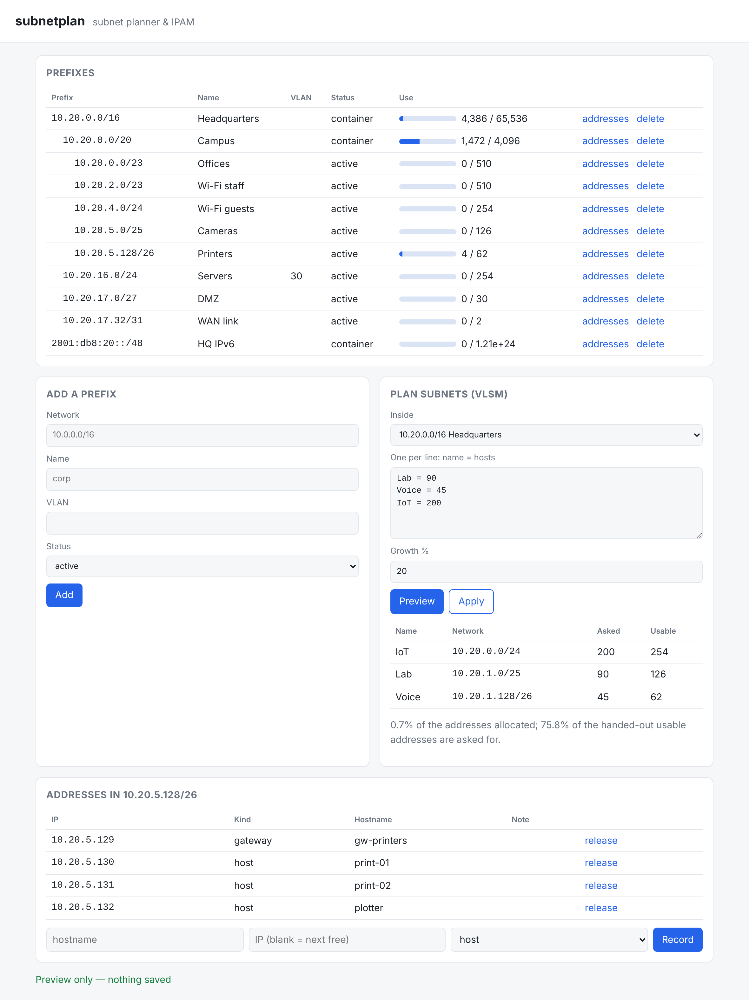

# subnetplan

[](https://github.com/TexAlphaWolf/net-subnet-planner/actions/workflows/ci.yml)
[](https://github.com/TexAlphaWolf/net-subnet-planner/actions/workflows/codeql.yml)

Subnet arithmetic, VLSM planning and a small IPAM, as a command line tool and a local web app.
IPv4 and IPv6. The core has **no dependencies** (only Python's `ipaddress`); the web interface needs FastAPI.



## What it does

- **Plan**: give it a network and named host counts (`office=200 guests=60 wan=2`), it returns the smallest
  block for each, largest first, packed with no gaps, and tells you what is left.
- **Split, summarize, free**: equal parts or a target prefix; the fewest CIDR blocks that cover a list; what remains of
  a network after removing blocks.
- **Check** a list of prefixes for duplicates and nesting.
- **IPAM** in one SQLite file: a prefix tree (with VRFs, VLANs, status), best-fit allocation from a parent, addresses
  per LAN (gateway, host, reserved), utilization, audit.

## Quick start

```bash
pip install "subnetplan[web]"           # or just: pip install subnetplan   (CLI only, no dependencies)

subnetplan plan 10.10.0.0/22 --need office=200 --need guests=60 --need servers=20 --need wan=2 --p2p wan --growth 20
subnetplan serve                        # http://127.0.0.1:8080
```

Or with Docker (the port is published on the loopback interface on purpose, see *Security*):

```bash
docker build -t subnetplan .
docker run --rm -p 127.0.0.1:8080:8080 -v subnetplan:/data subnetplan
```

Example (`examples/needs.csv` is the same thing from a file):

```text
$ subnetplan plan 10.10.0.0/22 --need office=200 --need guests=60 --need servers=20 --need wan=2 --p2p wan --growth 20
```

| name | network | asked | usable |
|---|---|---|---|
| office | 10.10.0.0/24 | 200 | 254 |
| guests | 10.10.1.0/25 | 60 | 126 |
| servers | 10.10.1.128/27 | 20 | 30 |
| wan | 10.10.1.160/31 | 2 | 2 |

Exit codes: `0` ok, `1` a problem was found (`check`, `audit`), `2` error or the request cannot be satisfied. `--json` on
every command.

## How it works, in short

Free space is kept as aligned power-of-two blocks (a buddy allocator). A request takes the smallest free block that
fits, lowest address first; freeing merges buddies back. With power-of-two sizes and largest-first order, a set of
requests fits **exactly when the sizes add up to no more than the free space**, which the tests verify rather than
assume. See [docs/architecture.md](docs/architecture.md).

## Measured

Everything below is produced by `python tools/evaluate.py` and stored in [docs/report.json](docs/report.json); details
and caveats in [docs/evaluation.md](docs/evaluation.md).

- **Correct**: 20700 random cases against the standard library and brute force, 0 mismatches.
- **Allocation quality** (churn on a /20, 15 runs per cell): at 90 % occupancy the buddy best-fit refuses 2.62 % of
  requests that the free space could have served, first-fit 3.69 %, next-fit 19.58 %. Below 75 % the first two are
  almost indistinguishable.
- **Fast**: conflict detection over 500000 prefixes in 2.73 s; the quadratic definition needs 14.19 s for 4000.

## Security

The web interface has **no authentication**. It binds to `127.0.0.1` by default, warns on any other address, sends a
strict Content-Security-Policy, builds its DOM with `textContent` only and validates every input. Do not expose it
without a reverse proxy that authenticates. See [SECURITY.md](SECURITY.md).

## Limits

An IPAM, not a network scanner: it records what you tell it. See [docs/limitations.md](docs/limitations.md).

## Development

```bash
pip install -e ".[web,dev]"
ruff check . && ruff format --check . && mypy && pytest -n auto --cov
python tools/evaluate.py --quick
```

## License

MIT, Luca Tessitore. All addresses in examples are documentation or private ranges.
